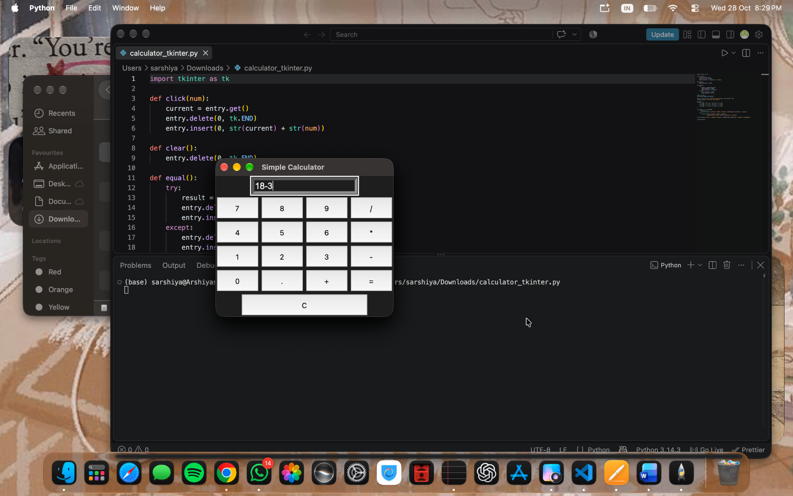
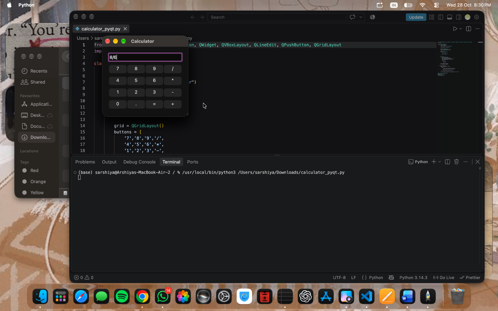

# Python GUI Calculator

A basic calculator built using Python with two different GUI libraries: Tkinter and PyQt5. This project explores building graphical user interfaces and handling basic arithmetic operations.

## Features

- Addition, subtraction, multiplication, and division
- Decimal number support
- Simple graphical user interface
- Error handling for invalid expressions
- Two implementations using different Python GUI libraries

## Screenshots

### Tkinter Version



### PyQt5 Version



## How to Run

### Tkinter Version

Tkinter is included with many Python installations.

```bash
python calculator_tkinter.py
```

### PyQt5 Version

Install PyQt5:

```bash
pip install PyQt5
```

Run the calculator:

```bash
python calculator_pyqt.py
```

## Technologies Used

- Python
- Tkinter
- PyQt5

## Note

Both implementations use Python's `eval()` to evaluate expressions. This is intended for a local learning project and should not be used with untrusted input.
